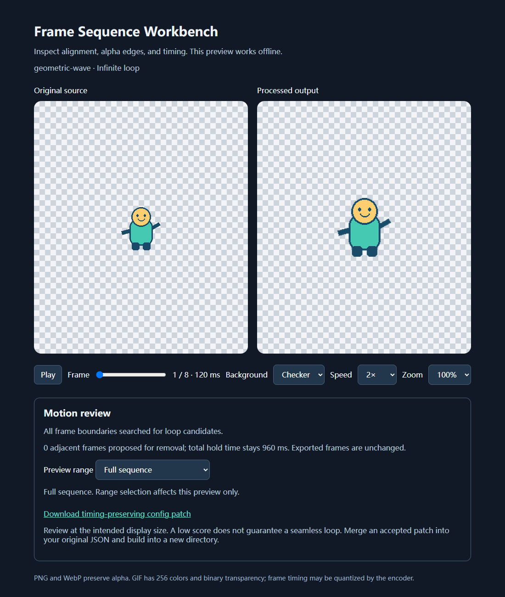

# Frame Sequence Workbench

将 PNG 帧目录、ZIP 或规则精灵表转换为对齐的透明动画素材。离线运行，保留原文件，提供可复现配置与独立 HTML 预览。

适合已有角色帧的脚底锚点校正、统一画布、重排帧和批量导出。不是绘画软件，也不生成中间帧。



## 安装与快速开始

需要 Python 3.11+。唯一运行时依赖为 Pillow。

```sh
python -m venv .venv
# Windows: .venv\Scripts\activate
# macOS/Linux: source .venv/bin/activate
python -m pip install .
python examples/generate_demo.py
frame-workbench build examples/directory.json --output examples/output-directory
```

在浏览器打开 `examples/output-directory/preview.html`，同步对比原图与处理结果，查看播放、逐帧滑块、背景切换、缩放和倍速。页面已内嵌全部原始帧及输出帧，可单独复制，无服务器和联网要求。输出目录必须不存在；重新构建请使用新目录。示例生成器同样拒绝覆盖已存在的 `examples/generated`。

```sh
frame-workbench build examples/zip.json --output examples/output-zip
frame-workbench build examples/sheet.json --output examples/output-sheet
```

也可运行 `python -m frame_workbench build ...`。Python API：

```python
from frame_workbench.pipeline import build
manifest = build("examples/directory.json", "new-output")
```

## 对齐的关键

`source_anchor: [64, 114]` 表示**原始单帧坐标中的脚底中心像素**。即使挥手改变透明边界，该点仍会被放到 `target_anchor: [0.5, 0.9]` 指定的画布位置。每帧脚底位置不同，可在 `frames` 内逐帧覆盖。只用 `anchor: "bottom-center"` 会跟随裁剪边界，左右挥手可能导致身体横向漂移。

所有帧共享一个 contain 缩放基准，保持相对体型；`scale` 统一缩放，逐帧 scale 再相乘。默认透明裁剪不拉伸宽高比。实际尺寸取整会有不足一像素的误差。参阅[完整配置](docs/configuration.md)。

`crop: [left, top, right, bottom]` 可显式裁剪原图区域，脚底锚点仍使用原图坐标。`action_id` 标识动作并写入 manifest；`loop` 为 `infinite` 或 `once`，同时作用于 GIF、WebP 和 HTML。精灵表示例演示只播放一次。

## 输出

| 文件 | 用途 |
| --- | --- |
| `frames/0000.png` 等 | 归一化透明帧，按播放顺序，包括重复帧 |
| `sheet.png` | 行优先精灵表，末尾空白格透明 |
| `animation.webp` | 无损透明动画；需要 Pillow 支持 WebP |
| `animation.gif` | 兼容预览；256 色、二值透明、时间量化 |
| `layers.ora` | 可选 OpenRaster，每帧一图层，初始只显示第一帧 |
| `manifest.json` | 来源索引、帧时间、裁剪及放置坐标 |
| `quality.json` | 空帧与裁切检测；不判断角色解剖或运动自然度 |
| `preview.html` | 全部内嵌的交互式离线预览 |

目录只读取顶层 PNG，按自然文件名排序（1、2、10）；ZIP 读取任意安全子目录中的 PNG。输入上限：512 帧、单张 16,777,216 像素、累计 67,108,864 像素、128 MiB 文件/展开数据。拒绝路径穿越、符号链接、加密 ZIP 和异常压缩比。详见配置文档。

## 开发

```sh
python -m pip install -e . build ruff
python -m unittest discover -s tests -v
ruff check .
python -m build
```

MIT © 2026 CASTyang。示例角色由仓库内几何绘图脚本原创生成。见[来源说明](docs/provenance.md)与[验证记录](docs/validation.md)。

## 可选 Codex skill

仓库附带 [character-motion-pipeline](skills/character-motion-pipeline/SKILL.md)，帮助组织角色帧、锚点、动作与验收步骤。将整个 `skills/character-motion-pipeline` 文件夹复制到 `~/.codex/skills/`（Windows 为用户目录下的 `.codex/skills/`）。skill 不包含 Python 工具安装，仍需先按上面的命令安装本包。

## 0.2：动作质检与保时长建议

新增透明度感知的相邻去重建议、循环区间推荐，以及像素画 `resample: "nearest"`。预览的 **Motion review** 可查看拟移除帧、下载配置片段、反复播放候选循环并恢复完整序列。

例如 `[A,A,B]` 的时长 `[80,120,100]ms` 会建议改为 `[A,B] + [200,100]ms`，保留总时长。建议写入 `quality.json` 与 `suggested-config.json`，原有导出仍按你的配置生成。先审核，再将片段合并到原配置的副本，在新目录重建。片段已使用来源索引，但不是完整配置文件。

```sh
frame-workbench build examples/analysis.json --output examples/output-analysis
```

上例复用快速开始生成的原创素材。精确视觉去重使用 `analysis: {"duplicate_threshold": 0}`；关闭分析使用 `analysis: {"enabled": false}`。循环评分只是辅助判断，不能保证无缝；超过 128 帧会抽样候选边界，但接缝始终检查真实相邻帧。

查看[配置与审核步骤](docs/configuration.md#motion-analysis-and-explicit-adoption)、[SpriteFrame 原理研究及证据](docs/spriteframe-research.md)。本次研究使用了 rea 与浏览器合成素材测试；AI 后端模型未知，仓库未包含网站代码或素材。

## English

An offline, reproducible PNG animation preparation CLI. Import a PNG directory, ZIP, or regular spritesheet; preserve alpha and aspect ratio; align original pixel anchors; edit frame order, timing, offsets and scales. Export PNG, sheet, lossless WebP, GIF, optional OpenRaster layers, a manifest, basic QA, and a self-contained interactive HTML preview.

Version 0.2 adds duration-preserving adjacent-frame removal proposals, heuristic loop-range previews, an explicit config-patch download and nearest-neighbor scaling for pixel art. Suggestions never silently change exported assets. See [motion review](docs/configuration.md#motion-analysis-and-explicit-adoption) and the [public-site research](docs/spriteframe-research.md).

Install with `python -m pip install .`, generate the original demo with `python examples/generate_demo.py`, then run `frame-workbench build examples/directory.json --output examples/output-directory`. Output directories must be new. Python 3.11+; Pillow is the only runtime dependency. See [configuration reference](docs/configuration.md) for the exact schema and limitations.
