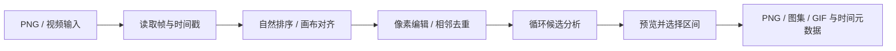

# SpriteFrame 公开工作流研究与实现映射

研究日期：2026-11-04。对象：[中文首页](https://spriteframe.com/zh/)与 [PNG 工作台](https://spriteframe.com/zh/png-to-sprite-sheet)。方法为公开页面、浏览器实际操作和公开下发 JavaScript 的静态分析。下文明确区分实测、代码推断及未知部分。

## 核心结论

SpriteFrame 把两类任务放在同一工作流：需要账号与积分的 AI 生成，以及可直接在浏览器完成的 PNG/视频加工。已经有帧时，关键能力来自帧的组织、像素处理、时间轴和导出元数据；无需先复刻 AI 后端。

本仓库据此实现了独立的离线分析：透明度感知的相邻帧比较、保留停留时长的去重建议、带运动接缝依据的循环候选，以及像素画最近邻缩放。代码使用 Pillow 重新编写，未复制网站代码或素材。

## 可确认的处理链



| 阶段 | 公开证据 | 实现方法与边界 |
| --- | --- | --- |
| AI 图生视频、AI 抠图 | 页面说明：登录、积分、上传 | 模型、提示词、推理和训练实现未知；未测试付费调用 |
| PNG 导入 | 浏览器实测乱序 10、2、1… 导入后按 1…10 排列 | 自然数字排序，保留来源文件名 |
| 本地视频解码 | Worker 中出现 WebCodecs `VideoDecoder`、轨道解封装与时间戳采样路径 | 静态代码支持此判断，本次未运行视频路径；没有据此声称所有浏览器均兼容 |
| 画布统一 | Worker 中最大源尺寸及居中、底部、左上对齐路径 | 统一画布与几何变换；不能推导人物脚底或骨骼 |
| 相邻去重 | 实测仅删相邻重复、关闭可恢复；代码比较前一保留帧 | 预乘透明度的像素差异与局部变化信号，避免隐藏 RGB 干扰 |
| 循环推荐 | 实测提供三组区间，预览与应用分开，可撤销 | 多尺度特征、时间邻域、质心移动与接缝优化共同评分，非“首尾相同即无缝” |
| 帧编辑 | 实测打开编辑器：颜色容差、羽化、收缩、擦除/恢复 | 控件存在已确认；具体抠图效果未测试 |
| 导出 | 实测下载本地生成的 PNG 图集 ZIP 与 JSON | 每个时间事件保留来源、持续时间、所在图集和矩形；事件与可复用视觉资源分开标识 |

### 去重：预乘透明度和局部差异

将颜色视为 `R×A、G×A、B×A、A` 后比较，完全透明的红色与蓝色应当相同。整体平均差异容易淹没眨眼等局部变化，因此局部块差异也有意义。

公开 `local-workspace` 中存在近似签名比较；Worker 的实际删除路径还会解码完整像素、比较前一保留帧，并缓存有限的像素/评分。两条路径的阈值映射不同，不能将其中某一公式直接当成所有模式的规则。Worker 路径的阈值表达式对应 `0.2 × strength/100`，并使用全局 RMS 与局部 8×8 分块信号；这是对当日该构建的静态观察，非稳定公开 API。

**实测时序差异：**输入十帧，默认 8 FPS，其中一对相邻帧完全一致。去重后导出九个 125ms 事件，总时长 1125ms；原十帧应为 1250ms。该测试路径没有把移除帧的停留时长转移给保留帧。不能据单次测试泛化所有模式，但这足以提示我们的时序策略需要明确。

本工具采用保时长建议：`[A,A,B] + [80,120,100]ms` → `[A,B] + [200,100]ms`。近似帧仍可能包含有意的细节变化，所以先提出建议供审核。

### 循环：看运动经过接缝时是否连贯

Worker 中可见不超过 64×64 的颜色/透明度/边缘特征、变化像素权重、邻帧距离、三帧弯曲、周期滞后搜索和位置移动分析。候选先粗排，再对较少候选进行完整像素的接缝细化，最后保留数个不同区间。静止帧或恰好重复的端点本身不足以证明循环质量。

本仓库实现的是较小的独立方案：24×24 预乘颜色特征衡量接缝距离；相对于时间中位背景的变化像素重心估计主体位移；按帧时长估计接缝前后速度。评分综合接缝/典型步长、速度变化和邻域外观差异。重心证据不足时降为需要审核，整体放慢播放不会让差的接缝自动获得更好评级。

这仍不是光流、骨骼或语义模型。对转身、遮挡、多个主体、局部肢体或快速闪烁可能判断失准；低分也不保证无缝。超过 128 帧时均匀采样候选边界，报告明确给出覆盖位置；接缝仍检查真实的相邻帧，避免抽样掩盖短暂反向。细小特征可能在缩略分析中丢失。最短候选四帧，最多返回三个。完全相同端点的区间不作为运动循环证据，因此可能漏掉合理的端点停顿。

## 本仓库的具体落地

| 能力 | 文件/入口 | 行为 |
| --- | --- | --- |
| 相邻帧分析 | `analysis.py` / `quality.json.analysis.duplicates` | 完整像素预乘 RMS 与近似局部分块能量，比较前一保留帧；阈值 0 为严格视觉相同 |
| 时间保留 | `suggested-config.json` | 只包含 `sequence` 和 `durations_ms`；使用原始来源索引；超过单帧上限的停顿拆成合法多帧 |
| 循环审核 | `preview.html` → Motion review | 候选切换、接缝指标、恢复完整序列；不修改导出文件 |
| 像素画缩放 | `resample: "nearest"` | 与默认 Lanczos 分开选择 |
| 可复现流程 | `character-motion-pipeline` skill | 对齐→构建→分析→视觉审核→接受配置片段→新目录重建 |

未来可独立评估视频抽帧、颜色背景处理、引擎导入器和完整编辑器。这些没有混入当前版本，也没有把帧插值或 AI 生成当成已实现功能。

## 研究证据与可复查性

安装的技能来自 [morluto/rea](https://github.com/morluto/rea)，固定提交 `c3647ade1e557c4179a8b825a37e0c2193cd2526`，路径 `.agents/skills/reverse-engineer-anything`。实际运行 REA CLI 6.8.0（独立 Node 24.22.1）对 `local-workspace` 与 `local-media.worker` 进行静态分析，未修改项目运行时依赖或注册 MCP。

命令结构：

```sh
rea analyze-javascript-application ./public-research \
  --source-path local-workspace-DmY_v8ky.js \
  --source-path local-media.worker-DK37JTs-.js \
  --detail summary --evidence_output ./rea-evidence.json --format json
```

Evidence：`ev_40054d9e434003b26480032984cc34b85d3a2e8a8901d753dbe546010d96e55e`；摘要：`ev_4367bc284b7dd35e652f3755245f852daffbe242d47da44055758f3a622125e8`。分析覆盖两份选定源文件，另有十个清单条目未深入检查；语义图达到每文件 20,000 节点的局部限制。结果与局部源码检查结合使用，不能宣称恢复了完整产品。

| 公开资源（均为 `https://spriteframe.com/assets/` 下） | SHA-256 |
| --- | --- |
| `animation-composer-BOH1eV5g.js` | `a1b3cd528d938c0b6cb79b60b4c20d4cf107fa648ab8ee6547b1cfb5ba34578c` |
| `png-to-sprite-sheet-BsyJoIy3.js` | `7dd4e8acc3c3a96c770a7a7c51e9b0d5707fd67605d3f6ffab5c4c577a5470be` |
| `sprite-workspace-CG4gLL3F.js` | `1f0b1b6189a7e438145e8af867313a0ce6b2b84b77589ba5c829ce343da11e2c` |
| `local-workspace-DmY_v8ky.js` | `73e26944e70dbbdf4a641842880987048c2b2bba407ca788d5ba5b4dc5cda199` |
| `local-media.worker-DK37JTs-.js` | `d5998a04095081c6025d0a66a4003576d348b83f32694416e0bb49fb657e62a0` |

便于核对的 Worker 字符位置（JavaScript 字符索引，非 UTF-8 字节）：特征函数 `Qi` 约 9404；循环分析类 `Xi` 约 10264；像素距离 `ts` 约 17640；Godot 导出 `Mo` 约 226516；时间构造 `qr` 约 227404；Canvas 创建 `ze` 约 228983。压缩符号仅针对上述哈希版本有意义。

浏览器使用隔离的 Chrome 与原创透明矩形测试帧；当前环境未提供 Browser 插件，故使用 Playwright。实测导入、相邻去重开关、循环候选预览/应用/撤销、ZIP 导出。未登录，未调用 AI 或付费功能。网络观察仅支持本次 PNG 路径在本地处理，不能证明所有功能离线。

原始第三方脚本、REA 大型证据文件、站点截图和临时网络日志仅保留在本地研究目录，未纳入仓库发行物。仓库发布这份方法与证据索引，网站代码、美术及商标不由本项目 MIT 许可覆盖。
